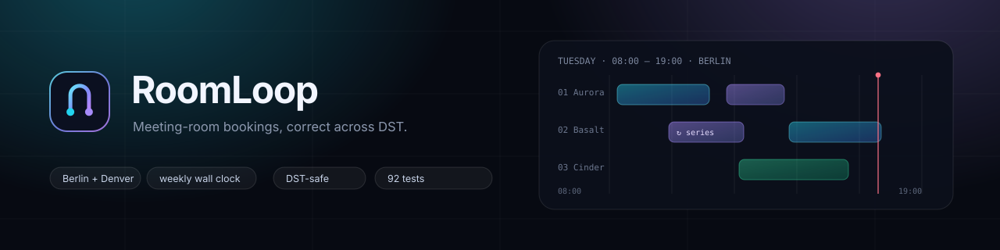
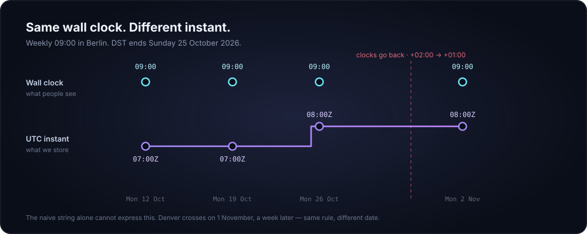
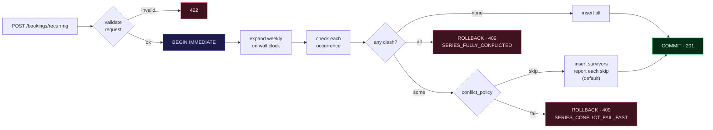

<div align="center">



<br>

**Booking core for meeting rooms.** Single bookings, weekly recurring series, cancellation,
and availability — correct across DST, in two offices, behind one small API.

[](#-how-this-was-verified)
[](#-quick-start)
[](https://fastapi.tiangolo.com)
[](#)
[](#-the-console)
[](LICENSE)

[Console](#-the-console) · [API](#-api-in-one-screen) · [Quick start](#-quick-start) ·
[Decision log](DECISIONS.md) · [API reference](docs/API.md) · [Interview walkthrough](docs/WALKTHROUGH.md)

</div>

---

## The brief, and what was actually hard

A ~200-person company books meeting rooms through an internal service. The original
was a prototype; this is the booking core built properly, with three constraints that
made it interesting:

| The trap | What it really means |
| --- | --- |
| **R1 vs R2 contradict each other** | "All-or-nothing" and "skip just the clashing weeks" cannot both be the default — so the policy is explicit per request |
| **"Denver bookings were an hour off"** | Two offices, two *different* DST dates, and a legacy naive-timestamp contract that cannot change |
| **The sample `/rooms` ids don't match the rule** | The example shows `3, 4, 9, 17`; requirement R5 says rooms are sequential `1..N` |

Everything below is a decision about those three, and the tests that pin them.

## The one idea that fixes the timezone bug



The requested string `2026-10-26T09:00:00` is identical either side of the transition,
but the **instant** is not: `07:00Z` before, `08:00Z` after. Storing the naive string
alone cannot express that — which is exactly how Denver ended up an hour off last winter.

So the storage is UTC epoch seconds, recurrence is expanded on **naive wall clocks**
(09:00 stays 09:00), and each occurrence resolves its own offset in the office's zone.
The legacy naive string is *derived* from a real instant, so the nightly report keeps
the exact format it parses today. Denver crosses on 1 November — same rule, its own date.

## How the recurring write is decided



Conflict checks and every insert share **one transaction**, so "nothing was saved" is
literally true. Two policies over the same guarantee: `skip` satisfies R2, `fail` gives
strict R1 rollback. An empty series is never saved — that would look like success.

## ✅ How each requirement is satisfied

| # | Requirement | Implementation | Pinned by |
| --- | --- | --- | --- |
| **R1** | Recurring create is all-or-nothing | One `BEGIN IMMEDIATE` around conflict checks and every insert; any exception rolls back (`roomloop/db.py::transaction`) | `test_strict_policy_saves_nothing`, `test_concurrency.py`, scenario *Strict mode…* |
| **R2** | Skip only clashing instances | Conflicts collected per occurrence, survivors inserted, every skip returned with its blocker | `test_clashing_occurrence_is_skipped_and_reported`, scenario *One clashing occurrence…* |
| **R3** | Same wall-clock time, two offices | Expansion steps naive datetimes by 7 days, then resolves each in the office zone | 5 domain tests + Berlin **and** Denver fall-back, plus the spring-forward gap |
| **R4** | Overlap in the same room; back-to-back is fine | Half-open intervals: `start_a < end_b and start_b < end_a` | `TestOverlap`, both boundary scenarios |
| **R5** | Iterate rooms by id `1..N` | `service.iter_rooms()` walks ids rather than trusting a list | `test_room_ids_are_sequential_for_iteration` |
| **C1** | Naive local ISO timestamps must not change | `start`/`end` still naive, second-precision, offset-free; extras are additive (`start_utc`, `utc_offset`, `timezone`) | `test_create_returns_legacy_naive_local_timestamps` |
| **C2** | Dashboard renders whatever comes back | Default `GET /rooms` is byte-for-byte the legacy shape; detail is opt-in | `test_rooms_payload_keeps_the_legacy_shape` |

<details>
<summary><b>Two smaller decisions worth knowing about</b></summary>

<br>

**DST edges are decided, not inherited.** A spring-forward time that does not exist
(`02:30` on 2027-03-28 in Berlin) is shifted forward and reported as `DST_GAP_SHIFTED`
— the meeting still happens, and the response says what happened. An ambiguous
fall-back time uses the first of the two instants. Both are tested.

**Cancelling frees the room immediately.** Cancellation is soft state: rows stay for
reporting, every conflict query filters `cancelled_at IS NULL`, so a cancelled series
can be re-booked at once. Past instances stay `confirmed`. Cancels are idempotent, and
there is a `scope=single` hatch for one week.

</details>

## 🖥 The console

<div align="center">
<sub>A zero-build UI served by the same process — every number comes from the live API.</sub>
</div>

| Area | What it shows |
| --- | --- |
| **Calendar** | One day per view: rooms as rows, office hours as columns. A dot under a date means that day has bookings, a thin red line marks now, and a one-line summary above the grid states how many rooms are free, how many bookings there are, and how much of the day is used. |
| **Booking drawer** | Wall-clock entry with a live preview of *local → stored → exact UTC instant*, duration chips, one-off or weekly, and a `skip` / `all-or-nothing` switch. Rejections name the blocking booking. |
| **Recurring** | One card per series: weekday and time, end date, and how many instances remain. Opening a card lists every instance with its UTC offset — the DST shift made visible. Cancel the whole future in one action. |
| **API explorer** | Ten curated calls fired at the running server, with status, latency and highlighted JSON. |
| **Notes** | R1–R5 and C1–C2 as short cards, for whoever opens the app without reading the repo. |

The interface is deliberately plain: one accent colour, two type sizes, and colour
reserved for a single distinction — one-off bookings are neutral, recurring ones are
accented. The dense version was harder to read than the API it wrapped.

```bash
python -m uvicorn roomloop.api:app --reload
# → http://localhost:8000/console     (Swagger: /docs)
```

Keyboard: `1`–`4` switch views · `←`/`→` change day · `n` new booking · `Esc` closes.

## 🔌 API in one screen

| Method | Path | Purpose |
| --- | --- | --- |
| `GET` | `/rooms` | Legacy payload: exactly `id`, `name`, `capacity` (C2). `?detail=true` adds office/timezone |
| `GET` | `/availability` | Free rooms for an exact window; iterates room ids `1..N` (R5) |
| `GET` | `/availability/day` | Free/busy grid + 30-minute bookable slots for one local day |
| `POST` | `/bookings` | Create one booking |
| `POST` | `/bookings/recurring` | Create a weekly series, all instances up front |
| `GET` | `/bookings`, `/bookings/{id}` | Active bookings in a window; one booking |
| `DELETE` | `/bookings/{id}?scope=series\|single` | Cancel; series-aware by default |
| `GET` | `/series`, `/series/{id}`, `DELETE /series/{id}` | List, inspect, cancel series |
| `GET` | `/meta`, `/health`, `/audit` | Policy constants, liveness (+ `timezone_data`), activity trail |

<details>
<summary><b>Example: create a series where one week clashes</b></summary>

<br>

```bash
curl -s localhost:8000/bookings/recurring \
  -H 'Content-Type: application/json' \
  -d '{
    "room_id": 1,
    "user": "platform@example.com",
    "start": "2026-11-02T09:00:00",
    "end":   "2026-11-02T10:00:00",
    "repeat_until": "2027-01-25",
    "conflict_policy": "skip"
  }' | jq
```

```jsonc
{
  "series_id": 7,
  "requested_count": 13,
  "created_count": 12,
  "skipped_count": 1,
  "created": [
    {
      "id": 13,
      "start": "2026-11-02T09:00:00",   // legacy: wall clock, no offset (C1)
      "start_utc": "2026-11-02T08:00:00Z",
      "utc_offset": "+01:00",
      "series_id": 7,
      "occurrence_index": 0
    }
  ],
  "skipped": [
    {
      "occurrence_index": 6,
      "start": "2026-12-14T09:00:00",
      "reason": "ROOM_BUSY",
      "conflicts_with": [
        { "id": 41, "user": "board@example.com",
          "start": "2026-12-14T09:30:00", "end": "2026-12-14T10:30:00" }
      ]
    }
  ]
}
```

Full request/response shapes and error codes: [`docs/API.md`](docs/API.md).

</details>

## 🚀 Quick start

**macOS / Linux**

```bash
python3 -m venv .venv && source .venv/bin/activate
pip install -r requirements-dev.txt
python -m roomloop.seed --reset
python -m uvicorn roomloop.api:app --reload
```

**Windows (PowerShell)**

```powershell
python -m venv .venv
Set-ExecutionPolicy -Scope Process -ExecutionPolicy Bypass   # this window only
.\.venv\Scripts\Activate.ps1
python -m pip install -r requirements-dev.txt
python -m roomloop.seed --reset
python -m uvicorn roomloop.api:app --reload
```

**Either platform, one command** — `./scripts/dev.sh` · `.\scripts\dev.ps1`
(venv → deps → timezone check → seed → run)

> **Use `python -m uvicorn`, not bare `uvicorn`** — the script shim is not on `PATH`
> until the virtualenv is active. `python -m pytest` for the same reason.

<details>
<summary><b>Something not working?</b></summary>

<br>

| Symptom | Cause | Fix |
| --- | --- | --- |
| `uvicorn : The term 'uvicorn' is not recognized` | Venv not active, so `.venv\Scripts` is not on `PATH` | Activate it, or always use `python -m uvicorn …` |
| `Unknown timezone 'Europe/Berlin'`, `/availability` returns 500 | No IANA timezone database — normal on Windows, common in slim containers | `python -m pip install tzdata` (already in `requirements.txt`) |
| `/health` shows `"timezone_data": "missing"` | Same as above | Install `tzdata`; `/health` names the problem explicitly |
| `No module named roomloop` | Command run outside the repo root | `cd` to the folder containing `roomloop\` |
| `Set-ExecutionPolicy ... cannot be loaded` | PowerShell blocks unsigned scripts | `Set-ExecutionPolicy -Scope Process -ExecutionPolicy Bypass` |

`/health` is the fastest diagnostic:

```bash
curl.exe -s localhost:8000/health
# {"status":"ok","service":"roomloop","rooms":5,"database":"file","timezone_data":"ok"}
```

If `timezone_data` is `missing`, nothing else matters until it is fixed — every
wall-clock calculation depends on it.

</details>

## 🧪 How this was verified

| Check | What it proves |
| --- | --- |
| **92 tests**, `python -m pytest -q` in ~2s | Every requirement and constraint has an executable definition |
| [`data/scenarios.json`](data/scenarios.json) — 12 scenarios, each with a `why` | The edge cases are reviewable as *data*, not buried in test code |
| `tests/test_concurrency.py` | Eight racing requests at one slot, exactly one wins — R1 is real, not asserted |
| Berlin **and** Denver around their own DST dates | The offset moves, the wall clock does not |
| A live browser run of every console flow | Rows, drawers and error states render from real responses — no mocks |
| A real Windows install | Caught the missing IANA database, which Linux never exposes |

Two bugs fixed here were invisible from reading the code: the SQLite transaction bug
only appeared under concurrent writes, and the timezone gap only appeared on a host
without the OS database. Both came from running it.

**On AI use:** this was built with AI as a pair programmer. It was dependable for
structure and wrong about semantics six times — UTC leaking into the legacy format,
implicit transactions, an impossible `02:30`, one shared error code, the sample ids,
and that timezone assumption. [DECISIONS.md §10](DECISIONS.md#10-where-ai-helped-and-what-it-got-wrong)
lists each defect with the damage it would have caused, the fix, and the test that
pins it. Review effort went exactly where the risk was: time, transaction boundaries,
error mapping.

## 📁 Project layout

```text
roomloop/
├── domain.py      pure rules — timestamps, DST, overlap, weekly expansion
├── db.py          SQLite schema, UTC-epoch storage, transactions, projections
├── service.py     use cases — create, create series, cancel, availability
├── api.py         FastAPI routes, error envelope, static console
├── demo.py        demo dataset (also powers the console reset button)
├── seed.py        CLI: python -m roomloop.seed
└── static/        console — index.html, styles.css, app.js (no build step)

data/scenarios.json   12 acceptance scenarios with rationale
tests/                92 tests: domain, API, scenarios, concurrency, environment
docs/                 API reference, interview walkthrough, diagrams
DECISIONS.md          trade-offs, open questions, AI usage, what is missing
```

<details>
<summary><b>Why an HTTP API and also a UI?</b></summary>

<br>

The brief allows a REST API *or* a CLI. An API is the right call: this core exists to be
consumed by other internal tools (the facilities dashboard already calls `GET /rooms`),
and the two hardest requirements — "skip just the clashing occurrences" and "cancel the
whole series easily" — are interactions, not flags. The console is served by the same
process with no build step, so a reviewer can verify both by clicking. If you only want
the API, ignore `/console`.

</details>

## 🗺 What I would do next

Auth and ownership (`user` is currently a free string), series editing with "this and
future" semantics, a Postgres exclusion constraint so the database enforces overlap too,
and calendar invites. The full list, including deliberate omissions and the questions
I would put to the PM before shipping, is in
[DECISIONS.md](DECISIONS.md#d-deliberately-left-out-and-what-id-do-next).

<div align="center">
<br>
<sub>Built for the RoomLoop take-home · <a href="DECISIONS.md">decision log</a> ·
<a href="docs/WALKTHROUGH.md">six-minute walkthrough</a></sub>
</div>
